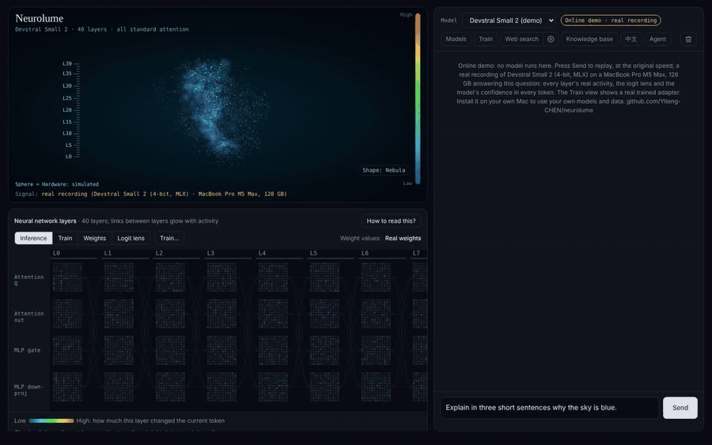

<div align="center">

# Neurolume

**Watch your model learn.**
Fine-tune an LLM on your Mac in a few clicks — and see, layer by layer, what training actually changed.

[](https://github.com/Yiteng-CHEN/neurolume/actions/workflows/ci.yml)


English · [简体中文](README.zh-CN.md)

</div>

<p align="center"></p>
<p align="center"><sub>Real run, not a mock-up: Devstral Small 2 on an M5 Max, recorded from the app's own canvases. Logit lens and per-layer activity are measured from the model (shown 1.25× speed).</sub></p>

Most fine-tuning tools stop at "training finished, loss = 1.23". Most interpretability tools show a model you cannot change. Neurolume puts both in one local app: **you train the model, and you watch its insides while you do it.**

> **Status: early alpha.** Server, UI and tooling are unit-tested (100+ tests, no GPU needed). Model loading and LoRA training were benchmarked on one machine (MacBook Pro M5 Max, 128 GB). Several MLX-side features — the live layer probe, logit lens, before/after switching and export — are written against the current mlx-lm API but have **not had a full hardware run yet**. Reports welcome.

## What you can do

**Fine-tune without writing code**
- **Bring data, or make it.** Drop in `.jsonl`, notes or code — or let the loaded model *generate* a dataset from your own files: Q&A pairs from documents, or "requests → your own code/writing" pairs that teach your style. You review and edit every item before training.
- **Guided LoRA training** with automatic checks (secret scan, de-duplication, train/validation split), live loss, speed and memory. The base model is never modified; the result is a separate adapter.
- **Did it work?** Validation loss *before → after* on data the model never trained on, a per-layer bar chart of how much each layer changed, and a **side-by-side comparison**: the same question answered by the original and the trained model (no reload — the adapter is switched off and on in place).
- **Take it anywhere.** Export the fused model as MLX (LM Studio loads it directly) or to **Ollama**.

**See inside the model**
- **Live brain view.** A 3D sphere or nebula with one band per real layer (Devstral Small 2: 40; Qwen3.6-27B: 64 with its linear/full-attention pattern). It discharges only while the model is generating or training.
- **Layer map.** Four weight matrices per layer with real weight values on hover, per-layer activity while generating, and the adapter's real ΔW while training.
- **Logit lens.** For each generated token, what every layer would predict "if the model stopped here" — watch the answer form layer by layer.
- **Replay.** Scrub through a finished answer token by token; the brain and the layer views go back to that moment.
- **"How to read this"** explanations for attention, MLP, linear attention, LoRA and the logit lens, in English and Chinese.

**Use it every day**
- Chat with an OpenAI-compatible local server (`/v1/chat/completions`, streaming), one-click model library, **knowledge base** (import books/docs for retrieval), opt-in **web search** for local models (also as an MCP server), and an **agent** that reads a project folder and proposes edits you approve one by one (with undo).

### Honest signals

Everything labelled as the model's activity comes from the model; simulated data is labelled. Full definitions in [`docs/SIGNALS.md`](docs/SIGNALS.md).

| Shown | Source |
|---|---|
| Layer count and types | Read from the loaded model |
| Weight values on hover | Exact strided sample of the dequantized weights |
| Per-layer activity | `mean\|out − in\| / mean\|in\|` of each block at the token being generated (switch between *enhanced* and *raw* display) |
| Logit lens | The model's own final norm + output head applied to intermediate layers |
| ΔW, per-layer change | Computed from the adapter (`scale · B·A`) |
| Validation loss before → after | mlx-lm's evaluation before the first update and at the end |
| Discharge paths on the sphere, colours, glow | Stylized (their frequency follows GPU/memory load and layer activity) |

## Quick start (macOS, Apple Silicon)

One line, no clone needed:

```bash
uvx --from "neurolume[mlx] @ git+https://github.com/Yiteng-CHEN/neurolume" neurolume serve --open
```

Or from a checkout (double-click `Neurolume.command`, or):

```bash
git clone https://github.com/Yiteng-CHEN/neurolume.git && cd neurolume
uv run --extra mlx neurolume serve --open      # http://127.0.0.1:8765
```

Need [uv](https://docs.astral.sh/uv/) (`brew install uv`). In the browser: **Models → Download** (Devstral Small 2 4-bit ≈ 15 GB) → **Load** → chat; **Train** opens the wizard. Without a Mac you can still open `src/neurolume/web/index.html` to see the UI in demo mode.

Data lives in `~/Library/Application Support/Neurolume`; models download into the checkout's `models/` folder (or the data folder when installed with `uvx`).

## Measured so far (M5 Max, 128 GB, mlx 0.32.4 / mlx-lm 0.32.2)

| | Qwen3.6-27B (8-bit) | Devstral Small 2 (4-bit) |
|---|---|---|
| Layers | 64 = 16 × (3 linear + 1 full attention) | 40, all full attention |
| LoRA, longest sequence that fit | 1024 (2048 ran out of memory, peak 115 GB) | ≥ 2048 |
| LoRA seconds / step | 10.1 | 4.4 |
| LoRA peak memory | 62 GB | 18 GB |

## Limits

- Apple Silicon only (MLX). One model at a time; training and chat don't run together.
- Fine-tuning teaches style and habits better than facts — use the knowledge base for documents.
- The logit lens costs about one extra output-head pass per shown layer per token, so it only runs while its view is open.
- Ollama export dequantizes the weights first (≈ 4× the size) and depends on Ollama supporting the architecture.

## How it is built

```
src/neurolume/web/         UI: index.html, css/, js/ (plain scripts, no build step)
src/neurolume/server/      local server: chat, library, training, data generation, export, knowledge base, agent
src/neurolume/telemetry/   per-layer probe and logit lens on MLX transformer blocks
src/neurolume/backends/    MLX backend, mocks, OpenAI-compatible client
src/neurolume/evals/       eval tooling: mine tasks from git history, sandboxed grading
docs/                      SIGNALS.md, decisions, plan
```

The server binds to `127.0.0.1` only. Neurolume never reads Claude / Codex / Hugging Face credentials.

## Contributing

Issues and pull requests are welcome — hardware reports (chip, memory, model, what worked) are especially valuable. See [CONTRIBUTING.md](CONTRIBUTING.md). Tests: `PYTHONPATH=src python -m unittest discover -s tests -t .`

## Related work

[M-Courtyard](https://discuss.huggingface.co/t/m-courtyard-fine-tune-llms-on-macos-with-zero-code-mlx-ollama-gui/173463) and [MLX-LoRA-Studio](https://github.com/Goekdeniz-Guelmez/MLX-LoRA-Studio) (no-code MLX fine-tuning); [llm-viz](https://github.com/bbycroft/llm-viz) and [Transformer Explainer](https://github.com/poloclub/transformer-explainer) (how transformers work); [TransformerLens](https://github.com/TransformerLensOrg/TransformerLens) and [llm-transparency-tool](https://github.com/facebookresearch/llm-transparency-tool) (research interpretability). Neurolume's focus is the overlap: a live, local model you train and inspect at the same time.

## License

[MIT](LICENSE). Neurolume was previously called *Cortex*; old links redirect.
