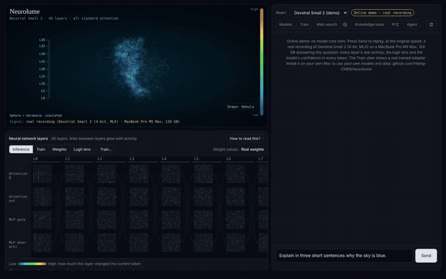

<div align="center">

# Neurolume

**看着你的模型学习。**
在 Mac 上点几下就能微调大模型，并且一层一层地看到训练到底改变了什么。

[](https://github.com/Yiteng-CHEN/neurolume/actions/workflows/ci.yml)


[English](README.md) · 简体中文

</div>

<p align="center"></p>
<p align="center"><sub>真实运行录屏，不是效果图：M5 Max 上的 Devstral Small 2，直接从应用自己的画布录制。逐层预测和逐层活动都来自模型的真实测量（1.25 倍速）· <a href="docs/media/demo.mp4">高清视频</a>。</sub></p>

大多数微调工具做到“训练完成，loss = 1.23”就结束了；大多数可解释性工具展示的模型你又改不了。Neurolume 把两件事放进一个本地应用：**你训练模型，同时看着它的内部发生了什么。**

> **状态：早期 alpha。** 服务、界面和工具链有 100 多个单元测试（不需要显卡）。模型加载和 LoRA 训练在一台机器上实测过（MacBook Pro M5 Max，128GB）。已在这台 Mac 上用 Devstral Small 2 真机验证：逐层探针、逐层预测（全部层）、引导式 LoRA 训练（36 步，峰值内存 15GB）、训练前后对比、导出 MLX 模型、用资料生成训练数据。导出到 Ollama 还没有真机测试。欢迎其他机器的反馈。

## 能做什么

**不用写代码就能微调**
- **有数据就导入，没有就生成。** 导入 `.jsonl`、笔记或代码；也可以让已加载的模型用你自己的资料**生成训练数据**：从文档生成问答对，或者从你写的代码/文章反推“需求”，答案就是你的原文，用来学你的风格。每一条都要你检查、可以修改。
- **引导式 LoRA 训练**：自动检查（剔除密钥、去重、划分训练/验证集），实时显示损失、速度和内存。原模型不会被改动，结果是一个单独的适配器。
- **到底有没有用？** 显示在没参与训练的数据上“验证集损失 训练前 → 训练后”，每层改变幅度的柱状图，以及**左右对比**：同一个问题，原模型和训练后的模型各答一次（不用重新加载，适配器临时关掉再打开）。
- **带到别处用。** 把合并后的模型导出为 MLX 格式（LM Studio 可直接加载），或导出到 **Ollama**。

**看见模型内部**
- **实时脑图**：球体或星云，每一段对应模型的一层（Devstral Small 2 是 40 层，Qwen3.6-27B 是 64 层并标出线性/全注意力）。只有模型在生成或训练时才会放电。
- **层图**：每层四个权重矩阵，悬停显示真实权重；生成时显示逐层活动，训练时显示适配器真实的 ΔW。
- **逐层预测（logit lens）**：每生成一个字，看每一层“如果在这里停下”会输出什么，答案是在第几层成形的一目了然。
- **回放**：回答完成后可以逐字拖动，脑图和层图回到生成那个字的时刻。
- **“这张图怎么看？”**：中英文讲解注意力、MLP、线性注意力、LoRA 和逐层预测。

**日常使用**
- 兼容 OpenAI 接口的本地服务（`/v1/chat/completions`，支持流式）、一键模型库、**知识库**（导入书和文档做检索）、可选的**联网搜索**（也提供 MCP 服务）、以及能读项目文件夹并逐条提出修改、由你批准、可撤销的 **Agent**。

### 信号都是真实的

界面上标为“模型活动”的数据都来自模型，模拟数据会明确标注。完整定义见 [`docs/SIGNALS.md`](docs/SIGNALS.md)。

| 显示内容 | 来源 |
|---|---|
| 层数和层类型 | 读取已加载的模型 |
| 悬停显示的权重 | 反量化后权重的等间隔精确采样 |
| 逐层活动 | 每层在正在生成的字上 `mean\|输出−输入\| / mean\|输入\|`（悬停可看原始测量值） |
| 逐层预测 | 把中间层结果送进模型自己的最终归一化和输出层 |
| ΔW、各层改变幅度 | 由适配器计算（`scale · B·A`） |
| 验证集损失 训练前 → 训练后 | mlx-lm 在第一次更新前和结束时的评估 |
| 球面上放电的走向、颜色、光晕 | 风格化（频率跟随显卡/内存占用和逐层活动） |

## 快速开始（macOS，Apple 芯片）

一行命令，不用克隆仓库：

```bash
uvx --from "neurolume[mlx] @ git+https://github.com/Yiteng-CHEN/neurolume" neurolume serve --open
```

或者克隆后双击 `Neurolume.command`，或运行：

```bash
git clone https://github.com/Yiteng-CHEN/neurolume.git && cd neurolume
uv run --extra mlx neurolume serve --open      # http://127.0.0.1:8765
```

需要先安装 [uv](https://docs.astral.sh/uv/)（`brew install uv`）。在浏览器里：**模型库 → 下载**（Devstral Small 2 4bit 约 15GB）→ **加载** → 聊天；点 **训练** 打开向导。没有 Mac 也可以直接用浏览器打开 `src/neurolume/web/index.html`，以演示模式看界面。

数据保存在 `~/Library/Application Support/Neurolume`；模型下载到仓库的 `models/` 文件夹（用 `uvx` 安装时放在数据文件夹里）。

## 实测数据（M5 Max，128GB，mlx 0.32.4 / mlx-lm 0.32.2）

| | Qwen3.6-27B（8bit） | Devstral Small 2（4bit） |
|---|---|---|
| 层数 | 64 = 16 ×（3 线性 + 1 全注意力） | 40，全部为全注意力 |
| LoRA 能跑的最长序列 | 1024（2048 内存不足，峰值 115GB） | ≥ 2048 |
| LoRA 每步秒数 | 10.1 | 4.4 |
| LoRA 峰值内存 | 62GB | 18GB |

## 限制

- 只支持 Apple 芯片（MLX）；同一时间只加载一个模型，训练和聊天不能同时进行。
- 微调更适合学习风格和习惯，不适合可靠地记住事实——文档知识请用知识库。
- 逐层预测每个字大约要多算一次输出层（每个显示的层），所以只在打开该视图时计算。
- 导出到 Ollama 需要先把权重还原成未量化格式（约 4 倍体积），并且取决于 Ollama 是否支持该模型结构。

## 代码结构

```
src/neurolume/web/         界面：index.html、css/、js/（普通脚本，无需构建）
src/neurolume/server/      本地服务：聊天、模型库、训练、数据生成、导出、知识库、Agent
src/neurolume/telemetry/   MLX 层探针与逐层预测
src/neurolume/backends/    MLX 后端、模拟后端、OpenAI 兼容客户端
src/neurolume/evals/       评测工具：从 git 历史挖题、沙箱判分
docs/                      SIGNALS.md、技术决定、计划
```

服务只监听 `127.0.0.1`，不会读取 Claude / Codex / Hugging Face 的凭证。

## 参与贡献

欢迎提 Issue 和 PR，尤其是真机运行报告（芯片、内存、模型、哪些能用）。见 [CONTRIBUTING.md](CONTRIBUTING.md)。运行测试：`PYTHONPATH=src python -m unittest discover -s tests -t .`

## 相关项目

[M-Courtyard](https://discuss.huggingface.co/t/m-courtyard-fine-tune-llms-on-macos-with-zero-code-mlx-ollama-gui/173463)、[MLX-LoRA-Studio](https://github.com/Goekdeniz-Guelmez/MLX-LoRA-Studio)（零代码 MLX 微调）；[llm-viz](https://github.com/bbycroft/llm-viz)、[Transformer Explainer](https://github.com/poloclub/transformer-explainer)（讲解 Transformer 原理）；[TransformerLens](https://github.com/TransformerLensOrg/TransformerLens)、[llm-transparency-tool](https://github.com/facebookresearch/llm-transparency-tool)（研究级可解释性）。Neurolume 的定位在它们的交叉处：一个你能同时训练和观察的本地模型。

## 许可证

[MIT](LICENSE)。Neurolume 原名 *Cortex*，旧链接会自动跳转。
